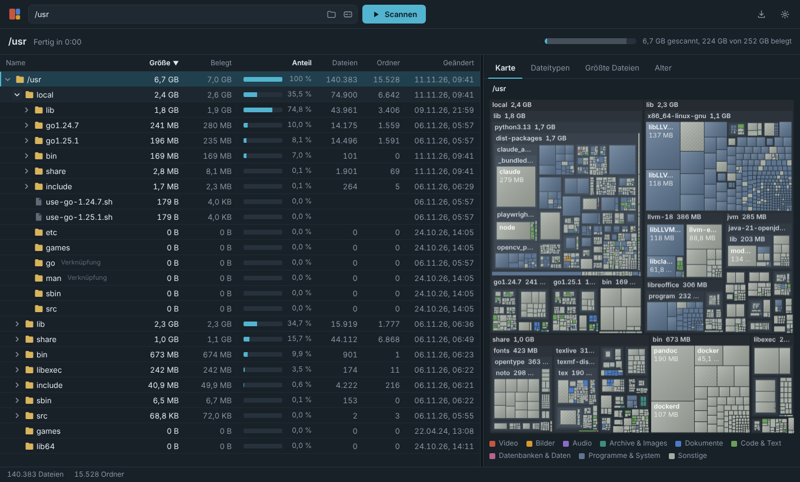

# SizeScope

Portabler Speicherplatz-Analysator für Windows – ähnlich wie TreeSize Free. Eine einzelne EXE, keine Installation.



## Funktionen

- **Ordnerbaum** mit Größe, belegtem Speicher, Anteil am übergeordneten Ordner, Anzahl Dateien/Ordner und Änderungsdatum – sortierbar, Spaltenbreiten anpassbar
- **Live-Ergebnisse**: Der Baum füllt sich schon während des Scans
- **Treemap** des gewählten Ordners, eingefärbt nach Dateityp oder Ordner
- **Dateitypen**: Speicher nach Endung und Kategorie
- **Größte Dateien** (filterbar nach Endung)
- **Alter**: Speicher nach Änderungsdatum
- Kontextmenü: Öffnen, im Explorer zeigen, Pfad kopieren, Ordner neu einlesen, in den Papierkorb verschieben
- CSV-Export, Neustart als Administrator, Ausschlussmuster (z. B. `node_modules`)
- Deutsch/Englisch, hell/dunkel

Junctions und symbolische Links werden nicht verfolgt (keine Doppelzählung). OneDrive-Platzhalter werden mitgezählt; „Belegt“ zeigt, was davon wirklich lokal liegt.

## Verwendung

`SizeScope.exe` starten, Laufwerk wählen. Optional mit Pfad starten: `SizeScope.exe D:\Daten`

Tastatur im Baum: Pfeiltasten, `Enter` öffnen, `F5` neu einlesen, `Entf` Papierkorb, `Strg+C` Pfad kopieren.

**Voraussetzung:** Windows 10/11 mit WebView2-Runtime (ist dort standardmäßig vorhanden).

**Portabel:** Einstellungen liegen als `SizeScope.settings.json` neben der EXE (falls der Ordner schreibgeschützt ist, unter `%APPDATA%\SizeScope`). WebView2-Daten landen im Temp-Ordner.

## Bauen

Benötigt Go und die Wails-CLI (`go install github.com/wailsapp/wails/v2/cmd/wails@v2.17.1`). Funktioniert auch von Linux aus:

```
wails build -platform windows/amd64 -skipbindings -s -trimpath -ldflags "-s -w"
```

Ergebnis: `build/bin/SizeScope.exe`.

**Release:** Version in `wails.json` (`info.productVersion`) erhöhen und auf `main` pushen – GitHub Actions baut die EXE und legt das Release `v<Version>` an. Text dafür: `.github/release-notes.md`.

Oberfläche ohne Windows testen: `go run -tags dev .` und `http://localhost:34115/dev/index.html` öffnen – das echte Scan-Backend läuft dabei per HTTP.

## Aufbau

| Pfad | Inhalt |
|---|---|
| `scanner/` | Paralleler Scan, Baum-Modell, Abfragen (Treemap, Typen, Top-Dateien, Export) |
| `app.go` | Schnittstelle zur Oberfläche |
| `platform_windows.go` | Laufwerke, Papierkorb, Explorer, Admin-Neustart |
| `frontend/dist/` | Oberfläche (HTML/CSS/JS ohne Build-Schritt) |
